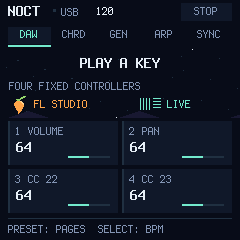
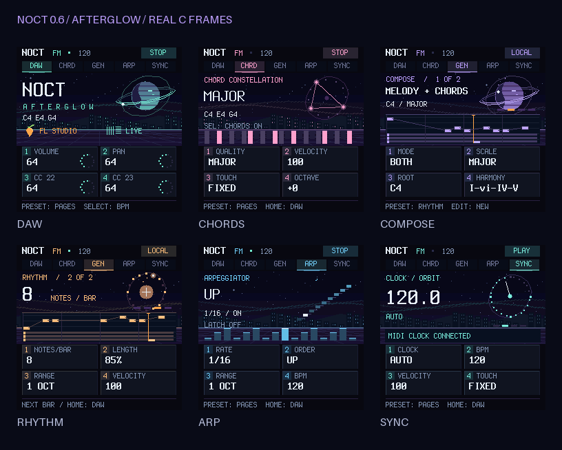

# NOCT / AFTERGLOW 0.6.0

**AFTER HOURS / IN CONTROL** — один постоянный MIDI-пресет для M-VAVE FM-1, FL Studio и Ableton Live.

**[Установщик и DAW-скрипты](https://joolo09.github.io/noct-fm/)** · **[Интерактивный эмулятор](emulator/README.md)**



## AFTERGLOW / визуальный мир

Ночной пиксельный город, кольца планеты, мерцающие звёзды, комета, движущаяся сетка и мягкое северное сияние. Каждая страница получает свой акцент: мята, розовый, сиреневый, янтарный и голубой. Значения ручек расположены на отдельных тёмных панелях, чтобы анимация не мешала чтению.

- DAW: вращающийся спутник, городские окна и частицы, реагирующие на Note On; логотипы FL Studio и Live.
- CHORDS: созвездие активных классов высоты и подсвеченная клавиатура с затуханием после Note Off.
- COMPOSE: piano roll из подготовленной фразы; отдельные слои аккордов и мелодии, указатель шага и четыре индикатора тактов.
- RHYTHM: круг из 16 шагов и пульсация от реально отправленных нот.
- ARP: световые ступени и ноты удержанного пула.
- SYNC: орбита 24 PPQN; движение от реального clock, явное ожидание при его потере.

Сцены рисуются целочисленным C-кодом в двух полосах 240×144 и 240×96, с ограничением обновления 20 FPS. Обработчик MIDI только обновляет короткую телеметрию; графика не выполняется в таймере. Это визуализация MIDI, не анализатор аудиосигнала. `tools/render-afterglow.py` записывает 144 реальных кадра и создаёт GIF; это не отдельный JavaScript-макет.



## Управление 0.5

Страница на экране определяет назначение четырёх ручек. Удерживать кнопки для настроек не требуется. **HOME** всегда возвращает CC20–23 для DAW. **PRESET** листает DAW → CHORDS → COMPOSE → RHYTHM → ARP → SYNC. Открытие страницы через PRESET не включает музыкальную функцию.

| Страница | K1 | K2 | K3 | K4 |
| --- | --- | --- | --- | --- |
| DAW / HOME | CC20 Volume | CC21 Pan | CC22 | CC23 |
| CHORDS | Тип аккорда | Velocity | Чувствительность | Октава |
| COMPOSE | Melody / Chords / Both | Major / Minor / Minor pentatonic | Корневая нота | Гармония |
| RHYTHM | Нот на такт 0–16 | Длительность 10–100% | Диапазон 1–3 | Velocity |
| ARP | Деление сетки | Порядок нот | Октавы ARP | BPM |
| SYNC | AUTO / INTERNAL / EXTERNAL | BPM | Velocity | Чувствительность |

На экране видны названия нот C4, D#4 и гармоний I-vi-IV-V, а также LOCAL / PLAY / STOP / WAIT. LOCAL означает генерацию при остановленной DAW. Четыре ручки на странице настроек **не отправляют** CC20–23; вернись HOME для управления микшером/автоматизацией. Входящий feedback DAW продолжает обновлять их значения.

| Кнопка/энкодер | Действие |
| --- | --- |
| HOME | Страница DAW, четыре постоянных CC |
| SEL | Клавиатурные аккорды вкл/выкл, страница CHORDS |
| ARP | Арпеджиатор вкл/выкл, страница ARP |
| SEQ | Генератор вкл/выкл, страница COMPOSE; не запускает DAW |
| EDIT | Новая фраза, страница COMPOSE; изменение со следующего такта |
| GLO | Открыть SYNC; источник clock остаётся прежним |
| PLAY | Пуск/стоп DAW; при локальной генерации первый нажим останавливает её |
| REC | Общая запись DAW вкл/выкл |
| FX | Эффекты выбранного mixer track FL / Device On выбранного устройства Live |
| ENV | Sustain, пока удерживается |
| LFO | Плавная модуляция CC1 вверх/вниз |
| OCT− / OCT+ | Транспонирование −3…+3 с корректными Note Off |
| SAVE | Сохранить при остановленных нотах и транспорте |
| SELECT | BPM +/−1 на любой странице |
| ALGORITHM | Быстрый выбор параметра: качество аккорда / гармония генератора / порядок ARP |
| PRESET | Выбор страницы; не меняет MIDI-канал или программу |
| MASTER | CC7 master DAW |

Удержание SEQ дольше 350 мс открывает COMPOSE без переключения воспроизведения при отпускании. SEQ + клавиша выбирает корень без лишней ноты. ARP + ENV — latch. FX + REC — panic. GLO + ENV — чувствительность; GLO + PLAY — переключение clock для совместимости. Основное управление доступно через видимые страницы.

## Генератор и музыка

Генератор сочиняет повторяемую фразу из четырёх тактов 4/4, отдельно от ARP и клавиатурного CHORDS. MELODY — мотив с паузами и синкопами, CHORDS — одновременное трезвучие на такт, BOTH — мелодия над аккордами. Трезвучия строятся по ступеням Major / natural minor с ближайшими обращениями. Minor pentatonic ограничивает мелодию пентатоникой; гармония остаётся natural minor.

Начни с PRESET → COMPOSE, выбери режим и гармонию, затем нажми SEQ. PRESET на один шаг вправо открывает RHYTHM. Изменения применяются на следующем такте, о чём сообщает NEXT BAR. EDIT создаёт новую мелодию и последовательность. После SAVE seed и настройки воспроизводятся после перезапуска. Автосохранения нет.

Генератор не запускается при загрузке. Stop гасит его ноты, сохраняя включённое состояние; PLAY/Start/Continue возобновляют воспроизведение. После Stop одна кнопка SEQ также возобновляет локальное прослушивание; второе нажатие останавливает и выключает генератор. Обычные удержанные клавиши от него независимы. При играющей DAW включение SEQ ждёт границу такта. Для фазовой синхронизации нужен MIDI Clock; BPM feedback передаёт только скорость.

AUTO использует clock при его наличии, а без него — внутреннюю сетку с BPM DAW. После захвата clock во время playback его потеря гасит ноты и показывает WAIT до возвращения clock. EXTERNAL всегда ждёт clock. Смена страницы ничего не меняет в синхронизации.

Клавиатура хроматическая F3–G5, ноты — канал 1. Клавиатурный CHORDS играет выбранный тип аккорда от каждой физической ноты. Синтезатор, USB audio и BLE отключены. Пользовательских банков и смены MIDI-канала с панели нет.

## Интерактивный эмулятор

`python tools/emulator.py --port 8766` после сборки host. Открой `http://127.0.0.1:8766/`. На Windows доступен `emulator/start.cmd`. Это постоянный процесс с тем же C-кодом, экраном и счётчиком владельцев MIDI-нот. В браузере доступны все кнопки, ручки, 27 клавиш, тестовый звук, MIDI-журнал и DAW Start/Stop/BPM/24 PPQN. Эмулятор слушает только 127.0.0.1 и не отправляет события реальному FM-1 или DAW.

Проверены вручную прямое изменение настроек, возврат HOME к CC, аккорды клавиатуры, запуск/остановка генератора, смена страниц, длительности/плотность и ожидающий clock. Эти сценарии дополнены автоматическими регрессионными проверками. Физический USB и клавиатурные датчики эмулятор не проверяет.

## Настройка FL Studio и Ableton

**DAW-скрипты 0.3 совместимы с прошивкой 0.5; переустанавливать их для генератора не требуется.** Они передают темп и FX. Скрипты 0.2 поддерживают только ноты, контроллеры и транспорт. Скрипты подключаются к одной DAW за раз.

**FL Studio:** папка `integrations/FL Studio/NOCT` → `Settings/Hardware/NOCT` внутри User data folder. Перезапусти FL, включи NOCT FM-1, выбери Controller type → NOCT FM. Входу и выходу назначь один Port number. Для двусторонней установки темпа нужна FL MIDI scripting API 38+ (`mixer.setCurrentTempo`), доступная в актуальной FL Studio. Для фазовой синхронизации включи Send master sync на выходе MIDI и Options → Enable MIDI master sync.

**Ableton Live 11/12:** папка `integrations/Ableton Live/NOCT` → `Remote Scripts/NOCT` внутри User Library. Перезапусти Live; Control Surface → NOCT; Input/Output → NOCT FM-1. Track включи для нот, Sync на MIDI-выходе — для MIDI Clock. Выбери MIDI-дорожку и инструмент; для FX выбери нужное устройство. Remote нужен только для дополнительных ручных MIDI Map.

| Ручка | FL Studio | Ableton Live |
| --- | --- | --- |
| KNOB 1 / CC20 | Volume выбранного mixer track | Volume выбранной track |
| KNOB 2 / CC21 | Pan выбранного mixer track | Pan выбранной track |
| KNOB 3 / CC22 | Stereo separation | Send A |
| KNOB 4 / CC23 | Volume выбранного channel | Send B |

BPM feedback работает и без Sync/Clock. Сами BPM-сообщения сообщают скорость, но не положение внутри такта: для точного старта по сетке включи MIDI Clock и используй Start/Continue. При отсутствии DAW-скрипта BPM оценивается по 24 входящим clock-сообщениям. При наличии скрипта приоритет у точного BPM DAW, чтобы не показывать дрожание из-за миллисекундного измерения.

Протокол на канале 16: CC7 master; CC20–23 ручки; CC110/111/112 play/stop/record; CC113 FX toggle (127), feedback состояния 0/127; CC114 BPM high и CC115 BPM low — 14-битное значение BPM×10, всегда парой; CC116/117 playback/recording feedback; CC119 value 2 — один MIDI-пресет. Ноты, sustain и modulation — канал 1. Обратная связь не эхоится и не вызывает запись flash.

## Установка, сборка и проверки

[Веб-установщик](https://joolo09.github.io/noct-fm/) работает в Chrome/Edge по HTTPS и USB MIDI SysEx. Пакет 0.6.0 имеет identity `FM-1_90625000600`. Проверяются SHA-256, размер, модель и identity после перезапуска. USB audio отсутствует; после установки проверь выбор MIDI-порта в DAW. Настройки 0.3 сохраняются при миграции; generator gate меняется на 85%, добавляются seed и выбор режима. Старые 0.1/0.2 также мигрируют в постоянную маршрутизацию.

Это экспериментальная прошивка. Перед установкой сохрани данные и подготовь официальный M-UPGRADE и процедуру восстановления для своей версии FM-1. Полный аппаратный цикл с двумя DAW ещё не проверен. Мы проверяем настоящую C-программу в симуляторе и скрипты с подставными DAW API; эти проверки не заменяют тест USB, flash и звука внутри DAW на реальном FM-1.

```sh
python tests/test_integrations.py
sh build.sh --host --no-ble
mkdir -p test-output
firmware/app/build/host/noct-usb_host tests/noct.ctl test-output
python tests/test_midi_engine.py
node tests/installer.test.mjs
sh build.sh --no-ble --release 0.6.0
```

CI проверяет 12 тестов DAW-скриптов, 15 сценарных тестов музыкального движка, 9 проверок управления и основной сценарий всех кнопок, 27 клавиш, 7 октав, CC, аккордов, совместного владения нотами, генератора, clock/BPM, Start/Stop/Continue, panic, сохранения и миграции. Сборка требует Linux x86-64, JieLi pi32v2 toolchain и AC79 SDK. Результат: `firmware/app/build/noct-usb-0.6.0.fwsc`. Сценарий GitHub Pages публикует последнюю успешную сборку. Исходники сайта — `site/`.

На Windows для host нужны Python 3.11+, Pillow и Zig 0.13.0; `tools/build-host.ps1 -NoBle`. Host — симулятор, он не управляет реальным MIDI и не прошивает устройство.

## Основа и лицензии

На основе [CTL-1](https://github.com/charlesvestal/fm1-ctl) `e181b4a1ac1510ce18ebf6e271a143c2fe364ccd`, fm1-base `b16c177a9086be955cd3e418383f2fd92c6d658b` и felucca-bsp `b4bb32ee0729595b7a30fbf239721286444eceb0`. Активное приложение: `app.c`, `project.c`, `note_bus.c`, `midi_engine.c`, `composer.c`, `midi_ui.c`, `midi_screen.c`, `control_screen.c`, `afterglow.c`, `midi_host.c`; старые UI/engine-файлы сохранены как исходный материал и не включены в сборку.

MPL-2.0 для приложения и модификаций; авторские заголовки сохранены. Лицензии: `LICENSE`, `upstream/LICENSING.md`, `upstream/LICENSES`, `upstream/base/`. Terminus — SIL OFL. Sonivox EAS сохранён в исходниках под Apache-2.0, но не линкуется в MIDI-сборку. Проект независим от M-VAVE, Image-Line и Ableton; логотипы обозначают совместимые DAW. Development identity экспериментальная.

Документация API: [Image-Line MIDI scripting](https://www.image-line.com/fl-studio-learning-content/fl-studio-online-manual/html/midi_scripting.htm), [Live Song: tempo и transport](https://docs.cycling74.com/apiref/lom/song/).
