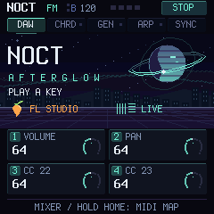

# NOCT FM

**MIDI controller firmware for the M-VAVE FM-1, made for FL Studio and Ableton Live.**

Keys, one-finger chords, a phrase generator, an arpeggiator, mixer knobs and DAW transport — on one fixed MIDI
preset. The FM-1's built-in synth is switched off: your DAW makes the sound.

**[Install from the browser](https://joolo09.github.io/noct-fm/)** · [Русская версия](README.ru.md) ·
[Changelog](CHANGELOG.md) · [Emulator](emulator/README.md)



> **Experimental firmware.** Keep the official M-UPGRADE tool and the recovery steps for your FM-1 at hand before
> installing (see [Safety and recovery](#safety-and-recovery)).

## Contents

- [What it does](#what-it-does)
- [Install](#install)
- [Connect your DAW](#connect-your-daw)
- [Controls](#controls)
- [The generator](#the-generator)
- [Lights and screen](#lights-and-screen)
- [Safety and recovery](#safety-and-recovery)
- [Development](#development)
- [Credits and licences](#credits-and-licences)

## What it does

| | |
| --- | --- |
| **Keyboard** | 27 keys (F3–G5), ±3 octaves, fixed velocity or key-sensed, optional lock to a scale |
| **Chords** | One key plays a chord: 11 types including *in key* and a learned *memory* chord; inversions, open, drop 2, strum |
| **Generator** | 4-bar phrases: melody, chords, bass or all three; 8 scales, 24 progressions + AUTO, 13 melody characters; 1000 variations per seed on the ALGORITHM dial |
| **Arpeggiator** | 7 orders, 1/4 … 1/32, 1–3 octaves, gate, swing, latch |
| **DAW control** | Mixer knobs, play / stop / record, FX, master, tap tempo; BPM and transport sync both ways |
| **MIDI** | Notes on channel 1 (generator can split to channels 1/2/3), controls on channel 16, MIDI Clock in |

## Install

1. Open **https://joolo09.github.io/noct-fm/** in Chrome or Edge on a computer.
2. Close your DAW, connect the FM-1 with a USB data cable and press **Connect**.
3. Press **Load** (or choose a downloaded `.fwsc`), tick the checkbox and press **Install**.

The installer checks the SHA-256, the size, the device model and, after the restart, the firmware identity. It
only accepts the NOCT build published with it. Settings from older NOCT versions are migrated automatically.

## Connect your DAW

Download the scripts from the site (or use [`integrations/`](integrations)). They pass tempo, transport, record
and FX state; notes need no script.

**FL Studio** — copy `integrations/FL Studio/NOCT` to `Settings/Hardware/` in your User data folder, restart FL,
pick NOCT FM-1 → Controller type **NOCT FM**, and give its input and output the same Port number. For clock sync
enable *Send master sync* on the output. Two-way tempo needs FL MIDI scripting API 38+.

**Ableton Live 11/12** — copy `integrations/Ableton Live/NOCT` to `Remote Scripts/` in your User Library,
restart Live, choose Control Surface **NOCT** with Input/Output **NOCT FM-1**, and enable *Track* on the input and
*Sync* on the output.

| Knob (DAW page) | FL Studio | Ableton Live |
| --- | --- | --- |
| K1 · CC20 | Mixer track volume | Track volume |
| K2 · CC21 | Mixer track pan | Track pan |
| K3 · CC22 | Stereo separation | Send A |
| K4 · CC23 | Channel volume | Send B |

Hold **HOME** for 0.6 s for **MIDI MAP**: K1–K4 then send CC24–27 for your own mappings (FL *Link to controller*,
Live *MIDI Map*).

**Three instruments from the generator** — on the SYNC page set K4 to **SPLIT**: melody on channel 1, chords on 2,
bass on 3. In FL give three channels MIDI input channels 1, 2, 3; in Live make three MIDI tracks with input NOCT
FM-1 and Ch. 1, Ch. 2, Ch. 3. The keyboard always plays on channel 1.

## Controls

The screen shows a page; the four knobs edit what that page shows. **PRESET** flips pages, **HOME** returns the
knobs to the DAW. Nothing on a settings page sends CC.

| Page | K1 | K2 | K3 | K4 |
| --- | --- | --- | --- | --- |
| **DAW** | CC20 volume | CC21 pan | CC22 | CC23 |
| **CHORDS** | Type (11) | Voicing | Strum 6–70 ms | Keys: chromatic / in scale |
| **COMPOSE** | Mode: melody, chords, both, bass, full | Scale (8) | Root | Progression (24) or AUTO |
| **RHYTHM** | Notes per bar 0–16 | Note length | Swing | Human (velocity accents) |
| **STYLE** | Chords: hold, pulse, offbeat, broken | Colour: triads, 7ths, add9, sus2, mixed | Range 1–3 oct | Melody character (AUTO + 13) |
| **ARP** | Rate | Order (7) | Octaves | Gate |
| **SYNC** | Clock: auto, internal, external | BPM | Velocity; below 1 = sensed | Generator out: ch 1 / split |

| Button | Action |
| --- | --- |
| **HOME** | DAW page; hold 0.6 s: mixer / MIDI map |
| **PRESET** (dial) | Next / previous page |
| **ALGORITHM** (dial) | Browse generator phrases #000–999, on any page |
| **SELECT** (dial) | BPM ±1 |
| **SEL** | Chords on; again on the CHORDS page: off |
| **SEL + 2–5 keys** | Learn a MEMORY chord |
| **SEQ** | Generator start / stop |
| **SEQ + key** | Set the generator root |
| **EDIT** | New seed (1000 new phrases); hold 0.6 s: also a new progression |
| **SEQ + EDIT** | Undo, up to 8 steps |
| **ARP** | Arpeggiator on / off (always off after power-on) |
| **ARP + ENV** | Latch |
| **GLO** | SYNC page; on the SYNC page: tap tempo |
| **PLAY / REC** | DAW transport; PLAY also stops a local generator preview |
| **FX** | FX of the selected FL mixer track / Live device on |
| **ENV** | Sustain while held |
| **LFO** | Mod wheel (CC1) up while held |
| **OCT− / OCT+** | Octave −3 … +3 |
| **SAVE** | Save settings (only while nothing is playing) |
| **FX + REC** | Panic: all notes off |
| **MASTER** | DAW master volume (CC7) |

There is no autosave: an orange square in the screen header means unsaved changes.

## The generator

Press **SEQ** to play a looping 4-bar phrase. With the DAW stopped it previews locally; with the DAW playing it
starts on the next bar and follows MIDI Clock. Changes apply from the next bar (`NEXT BAR` on screen).

- **Phrase.** Motif, answer, contrast and a cadence that ends on the tonic. Each variation picks a form
  (AABA, ABAB, AAAB, ABAC, ABBA), answers the motif as it is, inverted or backwards, and shapes the line as an arch,
  rise, fall or wave. Strong beats land on chord tones; nothing is out of key.
- **Melody characters** (STYLE K4): flow, arpeggio, riff, sequence, pedal, leaps, call and response, runs,
  ostinato, hook, turns, octaves, echo — or AUTO, a different one per variation.
- **Harmony.** 8 scales (major, minor, minor pentatonic, dorian, harmonic minor, major pentatonic, mixolydian,
  phrygian), 24 progressions per scale family — some change chord at beat 3 — or AUTO. Chords are voiced close to
  the previous one, without crossed voices.
- **Modes.** MELODY, CHORDS, BOTH, BASS (a bass line with chromatic approach notes) and FULL (bass + chords +
  melody).
- **Browsing.** Turn **ALGORITHM** to step through 1000 variations of the current seed; turning back returns the
  same phrase. **EDIT** picks a new seed. The variation number and all settings are kept by SAVE.

For the widest variety: COMPOSE K4 → AUTO, STYLE K2 → MIXED, STYLE K4 → AUTO, then turn ALGORITHM.

## Lights and screen

- **Bright keys** are notes actually sounding (keyboard, chords, generator, arp or MIDI coming in on channel 1).
  A key waiting for the next arp step glows dim. In *in scale* mode the scale glows dim.
- **Buttons**: steady bright = active, dim = available, a short pulse = the page you are on. PLAY is green while
  playing and red while recording.
- **Screen**: page tabs, BPM, a beat indicator, MIDI in/out, the transport state (STOP / LOCAL / PLAY / WAIT /
  ARMED) and an animated scene per page; COMPOSE shows the chord names of the phrase and a piano roll.

## Safety and recovery

- The bootloader, USB, OTA and flash code from fm1-base are **not modified**; NOCT is an application on top.
- Flash is written only when you press SAVE. Unknown or invalid settings fall back to defaults.
- Every release is built in CI with the device image checks (RAM, interrupt-safe code, register access) and
  the site publishes only a build that passed them.
- **If the FM-1 does not start:** hold OCT− and OCT+ for 5 seconds for update mode and restore the stock firmware
  with the official M-UPGRADE from [M-VAVE](https://www.m-vave.com/product?id=fm-1). If even that is not reachable,
  see [FM-1-transporter](https://github.com/kurogedelic/FM-1-transporter).

The firmware is tested in a simulator that runs the real C code (including 200 random fuzz sessions per build)
and against mocked DAW APIs. That does not replace a test on a real FM-1 with a DAW.

## Development

```sh
sh build.sh --host --no-ble                     # simulator build (Linux; Windows: tools/build-host.ps1 -NoBle)
for t in tests/test_*.py; do python3 "$t"; done  # scenario tests on the real C app
firmware/app/build/host/noct-usb_host tests/noct.ctl test-output
node tests/installer.test.mjs
python tools/emulator.py --port 8766            # interactive emulator at http://127.0.0.1:8766/
sh build.sh --no-ble --release 0.9.2            # device image (needs the JieLi pi32v2 toolchain and AC79 SDK)
```

- Firmware: [`firmware/app`](firmware/app) — `composer.c` (generator), `midi_engine.c` (clock, arp),
  `note_bus.c` (note ownership, chords, scales), `midi_ui.c` (controls), `afterglow.c` / `control_screen.c`
  (screen), `project.c` (settings and migration).
- Site and installer: [`site/`](site) (English and Russian). DAW scripts: [`integrations/`](integrations).
- Improving the firmware: [`docs/IMPROVE_PROMPT.md`](docs/IMPROVE_PROMPT.md) — no-brick rules, an audit checklist
  and a definition of done.
- MIDI protocol on channel 16: CC7 master; CC20–23 knobs (CC24–27 in MIDI map); CC110/111/112 play/stop/record;
  CC113 FX; CC114 + CC115 BPM×10 (14-bit, always as a pair); CC116/117 playing/recording feedback; CC119 value 2
  preset handshake.

## Credits and licences

Built on [CTL-1](https://github.com/charlesvestal/fm1-ctl) by Charles Vestal, fm1-base and felucca-bsp (Felucca by
Leo Kuroshita, Hügelton Instruments). The application and its changes are MPL-2.0 (`LICENSE`); see
`upstream/LICENSING.md` and `upstream/LICENSES` for the base. Terminus font: SIL OFL. Sonivox EAS stays in the
sources under Apache-2.0 but is not linked into the MIDI build.

NOCT is independent of M-VAVE, Image-Line and Ableton; their names identify compatible products.
