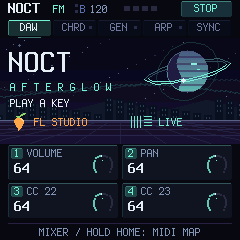

# NOCT FM

**MIDI-прошивка для M-VAVE FM-1 под FL Studio, Ableton Live и мобильные приложения — по USB и Bluetooth.**

Клавиатура, аккорды одним пальцем, генератор фраз, арпеджиатор, ручки микшера и транспорт DAW — в одном
постоянном MIDI-пресете. Встроенный синтезатор FM-1 выключен: звук делает DAW.

**[Установка из браузера](https://joolo09.github.io/noct-fm/)** · [English](README.md) ·
[История версий](CHANGELOG.md) · [Эмулятор](emulator/README.md)



> **Экспериментальная прошивка.** Перед установкой подготовь официальный M-UPGRADE и порядок восстановления для
> своей версии FM-1 (см. [Безопасность и восстановление](#безопасность-и-восстановление)).

## Содержание

- [Что умеет](#что-умеет)
- [Установка](#установка)
- [Подключение к DAW](#подключение-к-daw)
- [Bluetooth и приложения (Android, Koala Sampler)](#bluetooth-и-приложения-android-koala-sampler)
- [Управление](#управление)
- [Генератор](#генератор)
- [Подсветка и экран](#подсветка-и-экран)
- [Безопасность и восстановление](#безопасность-и-восстановление)
- [Разработка](#разработка)
- [Основа и лицензии](#основа-и-лицензии)

## Что умеет

| | |
| --- | --- |
| **Клавиатура** | 27 клавиш (F3–G5), ±3 октавы, фиксированная сила или по нажатию, привязка к ладу |
| **Аккорды** | Одна клавиша — целый аккорд: 11 типов, включая аккорды *в тональности* и *запомненный* аккорд; обращения, open, drop 2, страм |
| **Генератор** | Фразы на 4 такта: мелодия, аккорды, бас или всё вместе; 8 ладов, 24 прогрессии + AUTO, 13 характеров мелодии; 1000 вариаций на одно зерно на крутилке ALGORITHM |
| **Арпеджиатор** | 7 порядков, 1/4 … 1/32, 1–3 октавы, длина ноты, свинг, latch |
| **Управление DAW** | Ручки микшера, play / stop / record, FX, мастер, tap tempo; BPM и транспорт синхронизируются в обе стороны |
| **MIDI** | USB и Bluetooth LE MIDI одновременно (плюс вход TRS); ноты на канале 1 (генератор может разделить на 1/2/3), управление на канале 16; MIDI Clock на вход или на выход |

## Установка

1. Открой **https://joolo09.github.io/noct-fm/** в Chrome или Edge на компьютере.
2. Закрой DAW, подключи FM-1 USB-кабелем с передачей данных и нажми **Connect**.
3. Нажми **Load** (или выбери скачанный `.fwsc`), поставь галочку и нажми **Install**.

Установщик проверяет SHA-256, размер, модель устройства и после перезапуска — идентификатор прошивки. Он
принимает только сборку NOCT, опубликованную вместе с ним. Настройки прошлых версий NOCT переносятся
автоматически.

## Подключение к DAW

Скачай скрипты с сайта (или возьми из [`integrations/`](integrations)). Они передают темп, транспорт, запись и
состояние FX; для нот скрипт не нужен.

**FL Studio** — скопируй `integrations/FL Studio/NOCT` в `Settings/Hardware/` внутри User data folder,
перезапусти FL, выбери NOCT FM-1 → Controller type **NOCT FM** и назначь входу и выходу один Port number. Для
синхронизации по clock включи *Send master sync* на выходе. Двусторонний темп требует FL MIDI scripting API 38+.

**Ableton Live 11/12** — скопируй `integrations/Ableton Live/NOCT` в `Remote Scripts/` в User Library,
перезапусти Live, выбери Control Surface **NOCT**, Input/Output **NOCT FM-1**, включи *Track* на входе и *Sync* на
выходе.

| Ручка (страница DAW) | FL Studio | Ableton Live |
| --- | --- | --- |
| K1 · CC20 | Громкость mixer track | Громкость дорожки |
| K2 · CC21 | Панорама mixer track | Панорама дорожки |
| K3 · CC22 | Stereo separation | Send A |
| K4 · CC23 | Громкость канала | Send B |

Удержание **HOME** 0,6 с включает **MIDI MAP**: K1–K4 отправляют CC24–27 для своих назначений (в FL — *Link to
controller*, в Live — *MIDI Map*).

**Три инструмента из генератора** — на странице SYNC поставь K4 в **SPLIT**: мелодия идёт на канале 1, аккорды
на 2, бас на 3. В FL задай трём каналам MIDI-вход 1, 2, 3; в Live создай три MIDI-дорожки со входом NOCT FM-1 и
каналами Ch. 1, Ch. 2, Ch. 3. Клавиатура всегда играет на канале 1.

## Bluetooth и приложения (Android, Koala Sampler)

Прошивка принимает и отправляет MIDI **по USB и Bluetooth одновременно**. Bluetooth включается при запуске и виден
как **«FM-1»**; включить или выключить его можно на странице **LINK** (K1), выбор сохраняется по SAVE.

**На FM-1 (страница LINK)** для приложений без скриптов DAW:

1. K2 **HOST → APPS**: PLAY отправляет MIDI Start / Stop вместо команд скрипта.
2. K3 **CLOCK OUT → SEND**: FM-1 становится ведущим по темпу и отправляет MIDI Clock (чужой clock и Start он тогда
   игнорирует, но входящий Stop выполняет всегда).
3. K4 **KNOB CH → CH 1**, если приложение назначает контроллеры на канале нот.

**Android по USB:** подключи через переходник USB-C / OTG; в MIDI-настройках приложения включи вход FM-1 (и выход —
для clock и подсветки). **Android по Bluetooth:** *не* сопрягай FM-1 в системных настройках Bluetooth — MIDI-устройство
по Bluetooth должно открыть MIDI-приложение. Используй встроенный поиск Bluetooth MIDI в приложении, если он есть;
если нет — один раз подключись через приложение-коннектор Bluetooth MIDI, после чего FM-1 появится во всех
MIDI-приложениях. В Koala Sampler включи MIDI-вход от FM-1, а при CLOCK OUT — синхронизацию по внешнему MIDI clock.

У Bluetooth MIDI задержка больше, чем у USB; для точного тайминга лучше USB. Поведение Android и Koala зависит от
телефона и версии приложения и на реальном железе в этом проекте не проверялось.

## Управление

Экран показывает страницу; четыре ручки меняют то, что на ней видно. **PRESET** листает страницы, **HOME**
возвращает ручки в DAW. На страницах настроек ручки CC не отправляют.

| Страница | K1 | K2 | K3 | K4 |
| --- | --- | --- | --- | --- |
| **DAW** | CC20 громкость | CC21 панорама | CC22 | CC23 |
| **CHORDS** | Тип (11) | Раскладка | Страм 6–70 мс | Клавиши: хроматически / в ладу |
| **COMPOSE** | Режим: melody, chords, both, bass, full | Лад (8) | Тоника | Прогрессия (24) или AUTO |
| **RHYTHM** | Нот на такт 0–16 | Длина нот | Свинг | Human (акценты velocity) |
| **STYLE** | Аккорды: hold, pulse, offbeat, broken | Окраска: трезвучия, 7, add9, sus2, микс | Диапазон 1–3 окт | Характер мелодии (AUTO + 13) |
| **ARP** | Сетка | Порядок (7) | Октавы | Длина ноты |
| **SYNC** | Clock: auto, internal, external | BPM | Velocity; ниже 1 — по нажатию | Выход генератора: канал 1 / split |
| **LINK** | Bluetooth вкл / выкл | Хост: DAW / приложения | Выход clock | Канал ручек: 16 / 1 |

| Кнопка | Действие |
| --- | --- |
| **HOME** | Страница DAW; удержание 0,6 с: микшер / MIDI map |
| **PRESET** (крутилка) | Следующая / предыдущая страница |
| **ALGORITHM** (крутилка) | Листать фразы генератора #000–999 на любой странице |
| **SELECT** (крутилка) | BPM ±1 |
| **SEL** | Включить аккорды; повторно на странице CHORDS — выключить |
| **SEL + 2–5 клавиш** | Запомнить аккорд MEMORY |
| **SEQ** | Генератор пуск / стоп |
| **SEQ + клавиша** | Тоника генератора |
| **EDIT** | Новое зерно (1000 новых фраз); удержание 0,6 с — ещё и новая прогрессия |
| **SEQ + EDIT** | Отмена, до 8 шагов |
| **ARP** | Арпеджиатор вкл / выкл (после включения FM-1 всегда выключен) |
| **ARP + ENV** | Latch |
| **GLO** | Страница SYNC (PRESET → LINK); на ней — tap tempo |
| **PLAY / REC** | Транспорт DAW; PLAY также останавливает локальное прослушивание генератора |
| **FX** | FX выбранного mixer track в FL / Device On в Live |
| **ENV** | Sustain, пока держишь |
| **LFO** | Модуляция (CC1) вверх, пока держишь |
| **OCT− / OCT+** | Октава −3 … +3 |
| **SAVE** | Сохранить настройки (только когда ничего не играет) |
| **FX + REC** | Panic: снять все ноты |
| **MASTER** | Мастер-громкость DAW (CC7) |

Автосохранения нет: оранжевый квадрат в шапке экрана означает несохранённые изменения.

## Генератор

**SEQ** запускает повторяющуюся фразу на 4 такта. При остановленной DAW она звучит локально, при играющей —
стартует со следующего такта и идёт по MIDI Clock. Изменения вступают со следующего такта (`NEXT BAR`).

- **Фраза.** Мотив, ответ, контраст и каденция с окончанием на тонике. Каждая вариация выбирает форму (AABA,
  ABAB, AAAB, ABAC, ABBA), повторяет мотив как есть, зеркально или задом наперёд и строит рельеф: арка, подъём,
  спад или волна. На сильных долях — ноты аккорда, фальшивых нот нет.
- **Характеры мелодии** (STYLE, K4): flow, arpeggio, riff, sequence, pedal, leaps, call and response, runs,
  ostinato, hook, turns, octaves, echo — или AUTO, свой для каждой вариации.
- **Гармония.** 8 ладов (мажор, минор, минорная пентатоника, дорийский, гармонический минор, мажорная
  пентатоника, миксолидийский, фригийский), 24 прогрессии на семейство ладов — часть меняет аккорд на 3-й доле —
  или AUTO. Аккорды раскладываются ближе к предыдущему, без перекрещивания голосов.
- **Режимы.** MELODY, CHORDS, BOTH, BASS (бас-линия с хроматическими подходами) и FULL (бас + аккорды + мелодия).
- **Перелистывание.** Крути **ALGORITHM** — 1000 вариаций текущего зерна; поворот назад возвращает ту же фразу.
  **EDIT** берёт новое зерно. Номер вариации и все настройки сохраняются по SAVE.

Максимум разнообразия: COMPOSE K4 → AUTO, STYLE K2 → MIXED, STYLE K4 → AUTO, и крути ALGORITHM.

## Подсветка и экран

- **Яркие клавиши** — реально звучащие ноты (клавиатура, аккорды, генератор, арпеджиатор или входящий MIDI на
  канале 1). Клавиша, ждущая шага арпеджиатора, светится тускло. В режиме *в ладу* тускло светится лад.
- **Кнопки**: постоянный яркий свет — функция включена, тусклый — доступна, короткий импульс — открытая страница.
  PLAY зелёный при воспроизведении и красный при записи.
- **Экран**: вкладки страниц, BPM, индикатор долей, MIDI in/out, состояние транспорта (STOP / LOCAL / PLAY / WAIT
  / ARMED) и анимированная сцена на каждой странице; на COMPOSE — названия аккордов фразы и piano roll.

## Безопасность и восстановление

- Загрузчик, USB, OTA и запись во flash из fm1-base **не изменялись**; NOCT — приложение поверх них.
- Во flash пишется только по нажатию SAVE. Неизвестные или повреждённые настройки заменяются значениями по
  умолчанию.
- Bluetooth работает на неизменённом радиокоде fm1-base; если запуск Bluetooth когда-нибудь упадёт, fm1-base
  оставит его выключенным при следующем включении, а два сбоя при старте включат безопасный режим. Также собирается
  образ только с USB (артефакт CI `noct-usb-only`) на случай отката.
- Каждая версия собирается в CI с проверками образа (RAM, код прерываний, доступ к регистрам), и сайт публикует
  только сборку, прошедшую их.
- **Если FM-1 не запускается:** удерживай OCT− и OCT+ 5 секунд для режима обновления и верни штатную прошивку
  официальным M-UPGRADE с сайта [M-VAVE](https://www.m-vave.com/product?id=fm-1). Если и это недоступно, см.
  [FM-1-transporter](https://github.com/kurogedelic/FM-1-transporter).

Прошивка проверяется в симуляторе на настоящем C-коде (включая 200 случайных фаззинг-сеансов на каждую сборку) и
со скриптами на подставных API DAW. Это не заменяет проверку на реальном FM-1 с DAW.

## Разработка

```sh
sh build.sh --host --no-ble                     # сборка симулятора (Linux; Windows: tools/build-host.ps1 -NoBle)
for t in tests/test_*.py; do python3 "$t"; done  # сценарные тесты на настоящем C-приложении
firmware/app/build/host/noct-usb_host tests/noct.ctl test-output
node tests/installer.test.mjs
python tools/emulator.py --port 8766            # интерактивный эмулятор: http://127.0.0.1:8766/
sh build.sh --release 0.9.3                     # образ устройства, USB + Bluetooth (JieLi pi32v2 toolchain, AC79 SDK)
sh build.sh --no-ble --release 0.9.3            # образ только с USB
```

- Прошивка: [`firmware/app`](firmware/app) — `composer.c` (генератор), `midi_engine.c` (clock, арпеджиатор),
  `note_bus.c` (владение нотами, аккорды, лады), `midi_ui.c` (управление), `afterglow.c` / `control_screen.c`
  (экран), `project.c` (настройки и миграция).
- Сайт и установщик: [`site/`](site) (английский и русский). Скрипты DAW: [`integrations/`](integrations).
- Улучшение прошивки: [`docs/IMPROVE_PROMPT.md`](docs/IMPROVE_PROMPT.md) — правила «не окирпичить», чек-лист
  аудита и критерии готовности.
- Факты о железе и источники: [`docs/HARDWARE_FACTS.md`](docs/HARDWARE_FACTS.md).
- MIDI-протокол на канале 16: CC7 мастер; CC20–23 ручки (CC24–27 в MIDI map); CC110/111/112 play/stop/record;
  CC113 FX; CC114 + CC115 BPM×10 (14 бит, всегда парой); CC116/117 обратная связь воспроизведения/записи;
  CC119 = 2 — подтверждение пресета.

## Основа и лицензии

Основано на [CTL-1](https://github.com/charlesvestal/fm1-ctl) Чарльза Вестала, fm1-base и felucca-bsp (Felucca,
Leo Kuroshita, Hügelton Instruments). Приложение и изменения — MPL-2.0 (`LICENSE`); лицензии основы —
`upstream/LICENSING.md` и `upstream/LICENSES`. Шрифт Terminus — SIL OFL. Sonivox EAS остаётся в исходниках под
Apache-2.0, но не линкуется в MIDI-сборку.

NOCT не связан с M-VAVE, Image-Line и Ableton; их названия обозначают совместимые продукты.
